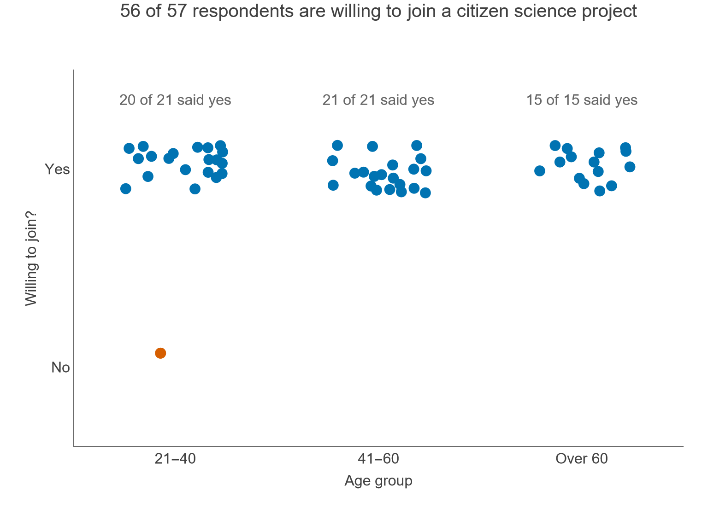
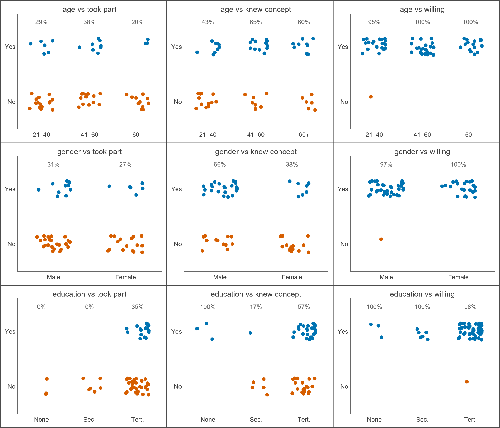

# Ekiti Citizen Science Survey

Cleaning and visualising a survey of 57 people in Ekiti State, Nigeria, on their willingness to take part in citizen science projects on biodiversity.

The workflow goes from a raw Excel survey export, through cleaning in **SQL (SQLite)**, to an interactive chart in **Mathematica**.



## Key finding

- **56 of 57 respondents (98%) are willing to join a citizen science project.** Willingness is high in every age group: 20 of 21 aged 21–40, 21 of 21 aged 41–60, and 15 of 15 aged over 60.
- Only **17 of 57** had taken part in biodiversity activities before. The interest is there. What's missing is the opportunity to take part.

## Comparing groups



The same strip plot is repeated for three respondent characteristics (rows: age group, gender, education) against three questions (columns: took part before, knew what citizen science is, willing to join). The percentage above each group is the share who answered yes.

- **Willingness is near-universal** in every group (95–100%).
- **Past participation is low** across the board (0–35%).
- **Awareness of citizen science varies more**, from 17% to 100% between groups.

**Caution:** the education groups are very uneven (48 tertiary, 6 secondary, 3 with no formal education). In a group of 3, one person changes the result by 33 percentage points, so those percentages should not be read as reliable differences.

## Workflow

1. **Raw data.** The survey was exported to Excel (18 columns, 57 rows) and saved as CSV.
2. **Import.** The CSV was imported into DB Browser for SQLite as a table named `survey_raw`.
3. **Clean (`sql/clean_survey.sql`):**
   - keeps only the three columns the main chart needs: age group, willingness and community
   - gives each respondent an ID
   - trims stray spaces and standardises case (`yes` → `Yes`, `>60` → `Over 60`)
   - adds numeric plot positions: `age_order` (1–3) and `willing_flag` (1 = yes, 0 = no)
   - standardises community names through a lookup table (`ado ekiti` → `Ado Ekiti`, `nil` → `Not stated`)
   - drops any row without a valid age group or answer (none were dropped)
4. **Check.** Verification queries confirm 57 respondents, the yes counts per age group, and that every community name was matched.
5. **Export.** The `survey_clean` table was exported to `survey_clean.csv`.
6. **Visualise:**
   - `mathematica/strip_plot.wl` draws the main chart from the cleaned data, with each respondent's community shown on hover.
   - `mathematica/strip_plot_grid.wl` draws the 3 × 3 grid. It needs more columns (gender, education, and the other questions), so it reads the original CSV.

## Why a jittered strip plot?

Both variables are categories: age was collected in three bands, and the answers as yes/no. A plain scatter plot would stack every respondent onto a handful of points. Small random offsets ("jitter") spread the dots so that every respondent is visible. A dot's exact position inside its cluster has no meaning. Only its column (group) and row (yes/no) do.

Other design choices:

- **The title states the finding**, rather than describing the axes.
- **Colour-blind-safe colours** (blue and vermillion) are used instead of red and green.
- **Counts or percentages sit above each group**, so readers don't have to count dots.
- **Clutter is removed.** There are no gridlines, no legend box and no extra axis lines.
- **The grid repeats the same design in every panel**, so readers learn to read one panel and can then compare across all nine.

## Repository structure

```
ekiti-citizen-science-survey/
├── README.md
├── .gitignore                 # keeps data files out of the repository
├── sql/
│   └── clean_survey.sql       # cleaning script + verification queries
├── mathematica/
│   ├── strip_plot.wl          # main chart: age group vs willingness
│   └── strip_plot_grid.wl     # 3 x 3 grid of strip plots
└── figures/
    ├── willingness.png
    └── survey_grid.png
```

## Data availability

The survey data is **not included** in this repository. With 57 respondents, combinations such as age group, gender and community could identify individuals. The data is available on request.

## Tools

- SQLite (DB Browser for SQLite)
- Wolfram Mathematica

## Author

Oladayo Omotayo
